<!-- ═══════════════ HEADER ═══════════════ -->
<div align="center">
  
</div>

<div align="center">
  <a href="https://git.io/typing-svg">
    
  </a>
</div>

<br />

<div align="center">
  <a href="https://www.linkedin.com/in/saufud-alehan-1b227a318/"></a>
  <a href="mailto:ufudjeff8@gmail.com"></a>
  <a href="https://www.instagram.com/saufudd/"></a>
  <a href="https://drive.google.com/file/d/1OPJdcbzA6BWWVBE6bCrugmU4XeNKhmNG/view?usp=sharing"></a>
</div>

<div align="center">
  
  <a href="https://github.com/saufud?tab=followers"></a>
  
</div>

<br />

<!-- ═══════════════ ABOUT ═══════════════ -->
## 👨‍💻 Tentang Saya <sub>/ About Me</sub>

<table width="100%">
  <tr>
    <td width="58%" valign="top">

Saya **Fullstack Developer** yang berfokus pada **backend engineering** dan **otomasi berbasis AI**. Saya suka mengubah alur kerja yang rumit menjadi sistem yang sederhana, otomatis, dan mudah di-scale, dengan arsitektur modular dan REST API yang bersih.

> *"Turn complex workflows into simple, automated, and scalable systems."*

- 🎓 **S1 Sistem Informasi** — Universitas Pamulang (UNPAM)
- 📍 Serang, Banten, Indonesia 🇮🇩
- 🗣️ Bahasa Indonesia · English

</td>
    <td width="42%" valign="top">

```ts
const saufud = {
  role: "Fullstack Developer",
  focus: ["Fullstack"],
  stack: ["Next.js", "Node.js", "Go", "PHP"],
  mindset: "Clean & Modular",
  learning: [
    "High Concurrency",
    "Distributed Cache",
    "Message Queue",
    "RAG & LLM APIs",
  ],
  openToCollab: true,
};
