<!-- ═══════════════ HEADER ═══════════════ -->
<div align="center">
  
</div>

<div align="center">
  <a href="https://git.io/typing-svg">
    
  </a>
</div>

<br />

<div align="center">
  <a href="https://www.linkedin.com/in/saufud-alehan-1b227a318/"></a>
  <a href="mailto:ufudjeff8@gmail.com"></a>
  <a href="https://www.instagram.com/saufudd/"></a>
  <a href="https://drive.google.com/file/d/1OPJdcbzA6BWWVBE6bCrugmU4XeNKhmNG/view?usp=sharing"></a>
</div>

<div align="center">
  
  <a href="https://github.com/saufud?tab=followers"></a>
  
</div>

<br />

<!-- ═══════════════ ABOUT ═══════════════ -->
## 👨‍💻 Tentang Saya <sub>/ About Me</sub>

<table width="100%">
  <tr>
    <td width="58%" valign="top">

Saya **Fullstack Developer** yang berfokus pada **backend engineering** dan **otomasi berbasis AI**. Saya suka mengubah alur kerja yang rumit menjadi sistem yang sederhana, otomatis, dan mudah di-scale, dengan arsitektur modular dan REST API yang bersih.

> *"Turn complex workflows into simple, automated, and scalable systems."*

- 🎓 **S1 Sistem Informasi** — Universitas Pamulang (UNPAM)
- 💼 **Fullstack Developer Intern** — PT Nusantara Data Cyber *(Okt 2026 · 3 bulan)*
- 📍 Serang, Banten, Indonesia 🇮🇩
- 🗣️ Bahasa Indonesia · English

</td>
    <td width="42%" valign="top">

```ts
const saufud = {
  role: "Fullstack Developer",
  focus: ["Backend", "AI Agent", "n8n"],
  stack: ["Next.js", "Node.js", "Go", "PHP"],
  mindset: "Clean & Modular",
  learning: [
    "High Concurrency",
    "Distributed Cache",
    "Message Queue",
    "RAG & LLM APIs",
  ],
  openToCollab: true,
};
```

</td>
  </tr>
</table>

<!-- ═══════════════ FOCUS ═══════════════ -->
## 🎯 Fokus Saat Ini

<table width="100%">
  <tr>
    <td align="center" width="33%">
      <h3>🌐 Full-Stack Web</h3>
      <sub>Next.js · React · Express.js<br/>Aplikasi web end-to-end</sub>
    </td>
    <td align="center" width="33%">
      <h3>⚙️ Backend Engineering</h3>
      <sub>Arsitektur modular · REST API<br/>High-concurrency systems</sub>
    </td>
    <td align="center" width="33%">
      <h3>🤖 AI & Automation</h3>
      <sub>RAG · LLM APIs · AI Agents<br/>Workflow otomatis dengan n8n</sub>
    </td>
  </tr>
</table>

<!-- ═══════════════ TECH STACK ═══════════════ -->
## 🛠️ Tech Stack

<div align="center">
  
</div>

<br />

<div align="center">

| Domain | Teknologi & Tools |
| :--- | :--- |
| **🎨 Frontend** |     |
| **⚙️ Backend** |        |
| **🗄️ Database** |     |
| **🤖 AI & Automation** |     |
| **☁️ Cloud & DevOps** |      |
| **🧪 Tools** |      |

</div>

<!-- ═══════════════ PROJECTS ═══════════════ -->
## 🚀 Proyek Unggulan <sub>/ Featured Projects</sub>

<table width="100%">
  <tr>
    <td colspan="2" valign="top">
      <h3 align="center">✨ HabitSense <sub>· Capstone Project (Tim)</sub></h3>
      <p align="center">
        Aplikasi web full-stack untuk melacak, menganalisis, dan membangun kebiasaan harian yang berkelanjutan, lengkap dengan dashboard yang intuitif.<br/>
        <i>A full-stack web app to track, analyze, and build sustainable daily habits.</i>
      </p>
      <p align="center">
        <code>Next.js</code> <code>React</code> <code>Tailwind CSS</code> <code>PostgreSQL</code> <code>Prisma</code>
      </p>
      <p align="center">
        <a href="https://habitsense.vercel.app/"></a>
      </p>
    </td>
  </tr>
  <tr>
    <td width="50%" valign="top">
      <h3 align="center">🧠 Digital Talent & RAG AI Platform</h3>
      <p align="center">
        Platform asesmen minat-bakat digital dengan penilaian otomatis, rekomendasi Generative AI berbasis RAG, dan dashboard konsultan.
      </p>
      <p align="center">
        <code>Node.js</code> <code>Express.js</code> <code>RAG</code> <code>React</code> <code>REST API</code>
      </p>
    </td>
    <td width="50%" valign="top">
      <h3 align="center">🛒 Full-Stack E-Commerce Engine</h3>
      <p align="center">
        Platform e-commerce end-to-end dengan Google OAuth 2.0, keamanan JWT, CRUD katalog produk, dan penyimpanan media cloud.
      </p>
      <p align="center">
        <code>Express.js</code> <code>OAuth 2.0</code> <code>PostgreSQL</code> <code>Cloudinary</code> <code>React</code>
      </p>
    </td>
  </tr>
  <tr>
    <td colspan="2" valign="top">
      <h3 align="center">🤖 AI Agent & n8n Automation</h3>
      <p align="center">
        Bot AI percakapan dan pipeline workflow otomatis yang mengintegrasikan LLM, Telegram, dan spreadsheet untuk operasional real-time.
      </p>
      <p align="center">
        <code>n8n</code> <code>AI Agents</code> <code>REST API</code> <code>Node.js</code> <code>Webhooks</code>
      </p>
    </td>
  </tr>
</table>

<!-- ═══════════════ JOURNEY ═══════════════ -->
## 🏆 Perjalanan & Sertifikasi <sub>/ Journey & Certifications</sub>

<table width="100%">
  <tr>
    <td width="6%" align="center">💼</td>
    <td><b>Fullstack Developer Intern</b> — PT Nusantara Data Cyber<br/><sub>Okt 2026 · Magang 3 bulan</sub></td>
  </tr>
  <tr>
    <td align="center">🎓</td>
    <td><b>ASAH 2026 — AI Fullstack Developer Cohort</b><br/><sub>Dicoding × GoTo</sub></td>
  </tr>
  <tr>
    <td align="center">🚀</td>
    <td><b>Top 30 Creative Future Tech Talent — Track AI</b><br/><sub>Kemenparekraf RI × Google</sub></td>
  </tr>
  <tr>
    <td align="center">💻</td>
    <td><b>Coding Camp — Fullstack Web Developer</b><br/><sub>DBS Foundation × Dicoding Indonesia</sub></td>
  </tr>
  <tr>
    <td align="center">📜</td>
    <td><b>Google AI Professional Certificate</b> · <b>BNSP Certified Junior Web Developer</b></td>
  </tr>
</table>

<!-- ═══════════════ STATS ═══════════════ -->
## 📊 GitHub Stats

<div align="center">
  
  
</div>

<div align="center">
  
  
</div>

<br />

<div align="center">
  
</div>

<!-- ═══════════════ CONTACT ═══════════════ -->
## 📫 Mari Berkolaborasi

<div align="center">

Punya ide proyek, peluang kolaborasi, atau sekadar ingin ngobrol soal backend & AI?<br/>
**Jangan ragu untuk menghubungi saya!**

<br />

<a href="mailto:ufudjeff8@gmail.com"></a>
<a href="https://www.linkedin.com/in/saufud-alehan-1b227a318/"></a>
<a href="https://www.instagram.com/saufudd/"></a>

</div>

<!-- ═══════════════ FOOTER ═══════════════ -->
<div align="center">
  <br />
  
  <br /><br />
  
</div>
